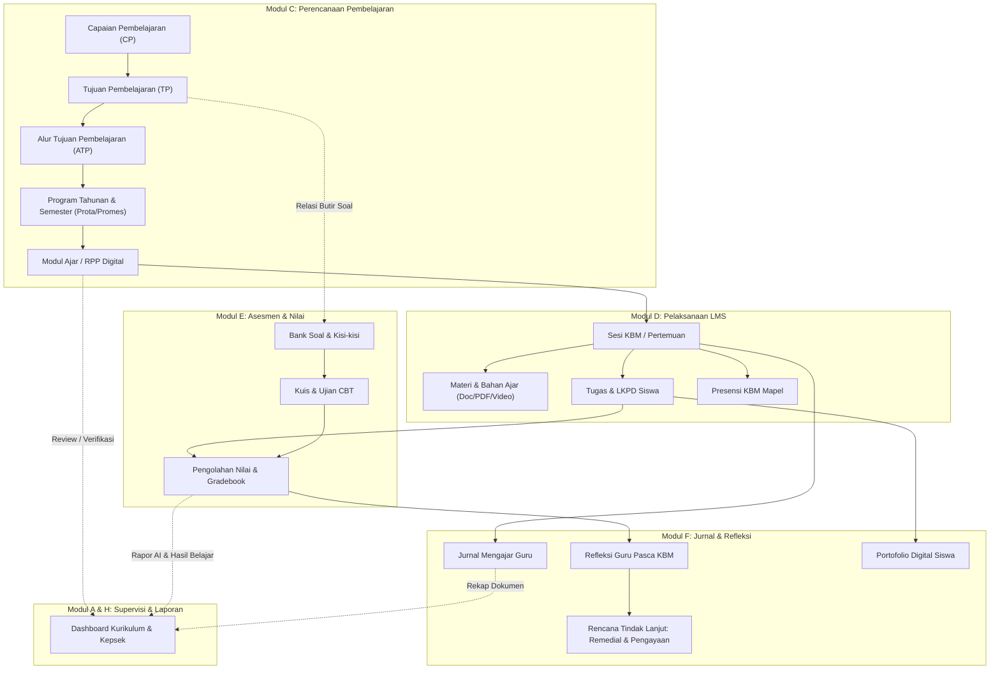

# ARSITEKTUR SISTEM (ARCHITECTURE)
**SMA1LE Learning System — SMAN 1 Lengkong**  
*Fondasi Laravel 13 & Desain Integrasi Menyeluruh*

---

## 1. Prinsip & Standar Arsitektur

SMA1LE Learning System dibangun di atas prinsip arsitektur yang modular, tangguh, aman, dan mudah dipelihara:
1. **Single Source of Truth**: Data master sekolah (Tahun Ajaran, Guru, Siswa, Rombel, dan Mata Pelajaran) menjadi referensi terpusat bagi seluruh modul (Perencanaan, LMS, CBT, Presensi, dan Raport).
2. **Non-Destructive Evolution**: Tidak menghapus atau merombak struktur database yang sedang beroperasi. Fitur-fitur baru diperkenalkan melalui tabel relasional tambahan yang terhubung rapi ke entitas eksisting (`course_classes`, `users`, `students`, `teachers`).
3. **Keterlacakan Pendidikan (Pedagogical Traceability)**: Setiap aktivitas KBM, tugas, dan butir asesmen dapat dilacak kembali ke Tujuan Pembelajaran (TP) dan Capaian Pembelajaran (CP) yang dirumuskan guru.
4. **Keamanan Bertingkat (Defense in Depth)**: Otorisasi berbasis Policy dan Middleware pada server, pencegahan IDOR melalui verifikasi kepemilikan data pada setiap request, dan penyimpanan berkas rahasia pada private disk.

---

## 2. Diagram Alur Keterlacakan Kurikulum & Pembelajaran



---

## 3. Struktur Modul & Skema Basis Data

Penyempurnaan modul pembelajaran mengintegrasikan tabel-tabel terstruktur berikut tanpa mengganggu tabel inti:

### A. Tabel Perencanaan Pembelajaran (Modul C)
- **`learning_outcomes` (CP)**: Menyimpan rumusan CP per fase (Fase E/F), tingkatan kelas, dan mata pelajaran.
- **`learning_objectives` (TP)**: Menampung tujuan pembelajaran, kode TP (misal: TP 10.1), materi pokok, alokasi jam tatap muka, dan indikator ketercapaian.
- **`learning_objective_flows` (ATP)**: Menyusun urutan logis penyampaian TP sepanjang semester/tahun ajaran.
- **`annual_programs` & `semester_programs` (Prota/Promes)**: Pemetaan distribusi jam efektif KBM mengacu pada kalender akademik.
- **`lesson_plans` (Modul Ajar / RPP)**: Dokumen perencanaan pembelajaran digital guru:
  - Kolom: `course_class_id`, `title`, `topic`, `grade_level`, `semester`, `duration_minutes`, `target_profile`, `learning_methods`, `learning_steps` (JSON: awal, inti, penutup), `assessment_plan` (JSON), `status` (`DRAFT`, `SUBMITTED`, `REVISED`, `APPROVED`), `reviewed_by`, `review_notes`.
- **`lesson_plan_tps` (Pivot)**: Relasi banyak-ke-banyak antara Modul Ajar dengan TP yang dipelajari.

### B. Tabel Pelaksanaan & Integrasi LMS (Modul D)
- **`course_classes` (Eksisting)**: Hub guru, kelas, mata pelajaran, dan jadwal KBM.
- **`lms_materials` & `lms_assignments` (Eksisting Terintegrasi)**: Ditambahkan kolom opsional `tp_id` untuk menghubungkan bahan ajar dan tugas secara langsung ke Tujuan Pembelajaran.
- **`lms_teaching_journals` (Eksisting Terintegrasi)**: Mencatat pelaksanaan materi di kelas per tanggal.

### C. Tabel Asesmen & Nilai (Modul E)
- **`lms_quizzes` & `lms_quiz_questions` (Eksisting Terintegrasi)**: Mendukung bank soal, kisi-kisi per TP, kartu soal, tipe soal (Pilihan Ganda & Esai), serta scoring otomatis.
- **`remediation_enrichment_plans`**: Mencatat daftar siswa yang memerlukan penanganan khusus remedial beserta bentuk tugas perbaikan dan asesmen ulangnya.

### D. Tabel Refleksi, Portofolio & Supervisi (Modul F & H)
- **`teacher_reflections`**: Formulir refleksi guru terhubung ke mata pelajaran dan TP:
  - Pertanyaan evaluasi: ketercapaian tujuan belajar, kendala siswa dalam memahami materi, efektivitas media/metode yang digunakan, serta tindak lanjut pertemuan berikutnya.
- **`student_portfolios`**: Kurasi bukti belajar terbaik siswa (tugas, karya digital, proyek P5) yang dapat diakses siswa, guru, dan orang tua.

---

## 4. Desain Lapisan Layanan AI (Modul G)

AI dirancang sebagai **asisten produktivitas guru** dengan pola *Adapter Pattern*:

```
[ Controller / Web UI ]
          │
          ▼
[ AiCurriculumService ]  (Validasi konteks, pembatasan rate limit, pencatatan log)
          │
          ▼
[ AiProviderAdapterInterface ]
     ├── GeminiAiAdapter (Google Gemini API - Primary)
     └── MockAiAdapter   (Pengujian lingkungan test / fallback darurat)
```

### Standar Keamanan & Etika AI:
1. **Status Wajib Draf**: Semua hasil buatan AI (draf TP, draf modul ajar, butir soal kuis, saran remedial) otomatis berstatus `DRAFT`. Guru wajib memeriksa dan menyetujui sebelum digunakan siswa.
2. **Privasi Siswa**: Data pribadi siswa (nama lengkap, NIK, alamat) **tidak pernah dikirimkan** ke prompt API publik. Hanya konteks akademik teragregasi (misal: "3 siswa belum tuntas pada indikator X") yang disertakan.
3. **Penyimpanan Kunci API**: Kunci API disimpan eksklusif pada variabel `.env` di server, tidak pernah terekspos ke sisi klien.

---

## 5. Standar Antarmuka UI/UX Responsif

1. **Konsistensi Sub-Navigasi**: Menggunakan kontainer sub-menu horizontal berbasis tab dengan styling `flex flex-wrap items-center gap-1.5 sm:gap-2` untuk navigasi bebas hambatan dan tidak terpotong pada berbagai perangkat (mobile, tablet, desktop).
2. **Hierarki Visual Jelas**: Kartu materi dan perencanaan menggunakan badge status semantik:
   - Draf: `bg-slate-100 text-slate-700`
   - Diajukan: `bg-amber-100 text-amber-800`
   - Disetujui: `bg-emerald-100 text-emerald-800`
   - Perlu Revisi: `bg-rose-100 text-rose-800`
3. **Komponen Aksesibel**: Ukuran tombol minimal 40px pada tampilan layar sentuh, font sans-serif dengan kontras tinggi, dan tata letak form satu kolom di layar smartphone.

