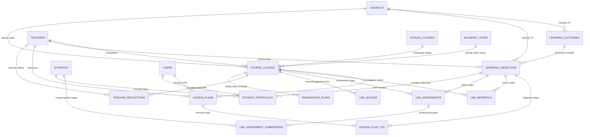

# ENTITY RELATIONSHIP DIAGRAM (ERD) — SMA1LE LEARNING SYSTEM
**Arsitektur Basis Data Perencanaan Pembelajaran, LMS, Asesmen & Refleksi**  
*SMAN 1 Lengkong — Laravel 13*

---

## 1. Diagram Relasi Entitas Terpadu (Mermaid ERD)

---

## 2. Alur Keterlacakan Pedagogis (Pedagogical Traceability Flow)

1. **Capaian Pembelajaran (CP)**: Standar kompetensi per fase (Fase E/F) dari Kementerian Pendidikan Dasar dan Menengah.
2. **Tujuan Pembelajaran (TP)**: Jabaran operasional kompetensi dan ruang lingkup materi yang dirumuskan guru per mata pelajaran.
3. **Alur Tujuan Pembelajaran (ATP)**: Rangkaian urutan penyampaian TP secara sistematis sepanjang semester.
4. **Modul Ajar / RPP Digital**: Perencanaan detail pertemuan KBM (Apersepsi, Kegiatan Inti, Penutup, LKPD, Rubrik) yang mengaitkan satu atau beberapa TP via tabel pivot `lesson_plan_tps`.
5. **Pelaksanaan LMS**: Materi (`lms_materials`) dan tugas (`lms_assignments`) menautkan `learning_objective_id` agar ketercapaian siswa dapat diukur secara presisi.
6. **Refleksi & Remedial**: Pasca KBM, guru mencatat refleksi (`teacher_reflections`) dan menyusun rencana tindak lanjut remedial (`remediation_enrichment_plans`) bagi siswa yang memerlukan bimbingan tambahan.

